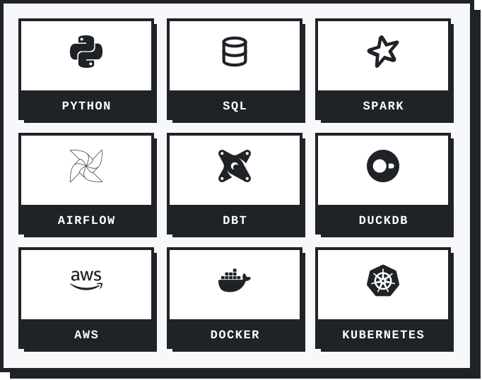

<picture>
  <source media="(prefers-color-scheme: dark)" srcset="./assets/banner-dark.svg"/>
  
</picture>

 
 

<h3>Data only becomes a decision when the path to it can be trusted. That path is what I build.</h3>

 

<picture>
  <source media="(prefers-color-scheme: dark)" srcset="./assets/divider-dark.svg"/>
  
</picture>

## 01 / About me

I'm a data engineer, and I spend most of my time building the path data travels: from a messy source (an API, a website, a file nobody ever documented) to the table someone trusts enough to make a decision.

I build and evolve data platforms, with pipelines, Data Lakes and Data Warehouses. Day to day that means ingesting data from APIs and web scraping, transforming it with SQL and dbt, orchestrating with Airflow and running it all on AWS. I'm also the technical lead of the Data team, taking part in architecture decisions, setting priorities and steering the team.

 

<picture>
  <source media="(prefers-color-scheme: dark)" srcset="./assets/divider-dark.svg"/>
  
</picture>

## 02 / Tech stack

  <picture>
    <source media="(prefers-color-scheme: dark)" srcset="./assets/stack-dark.svg"/>
    
  </picture>

 

<picture>
  <source media="(prefers-color-scheme: dark)" srcset="./assets/divider-dark.svg"/>
  
</picture>

## 03 / Let's connect

  <a href="https://www.linkedin.com/in/lucasdantasabreu/">
    <picture>
      <source media="(prefers-color-scheme: dark)" srcset="./assets/btn-linkedin-dark.svg"/>
      
    </picture>
  </a>

