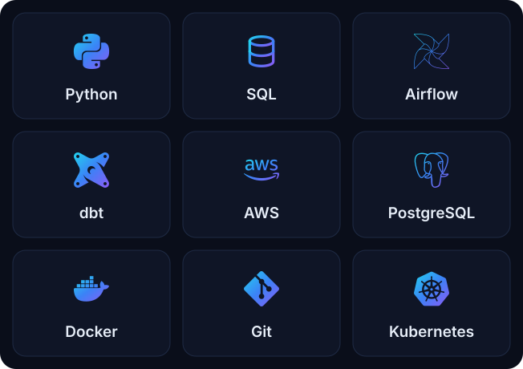

 
 

<h3>Dado só vira decisão quando o caminho até ela é confiável. É esse caminho que eu construo.</h3>

 

## Sobre mim

Sou engenheiro de dados e passo boa parte do tempo construindo o trajeto que o dado percorre: da origem bagunçada (uma API, um site, um arquivo que ninguém documentou) até a tabela em que alguém confia para tomar uma decisão.

Trabalho na construção e evolução de plataformas de dados, com pipelines, Data Lakes e Data Warehouses. No dia a dia isso passa por ingestão via APIs e Web Scraping, transformação com SQL e dbt, orquestração no Airflow e infraestrutura na AWS. Hoje também atuo na liderança técnica da área de Dados, participando das decisões de arquitetura, da definição de prioridades e do direcionamento do time.

 

## Tecnologias

  

 

## Conecte-se comigo

  

